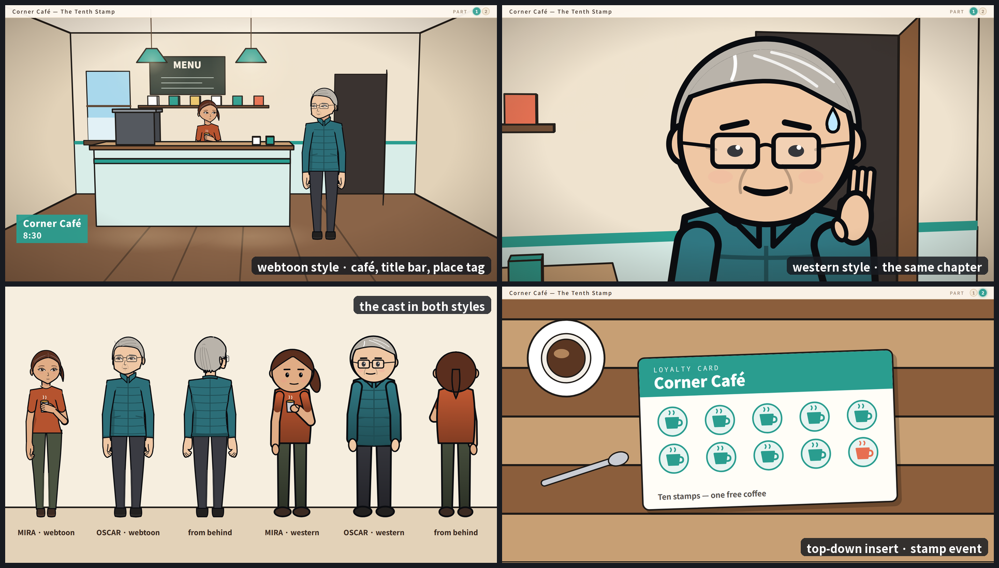

# Skink engine

Skink is a 2D animated-video engine built on top of [Remotion](https://www.remotion.dev): a layer of characters, staging, a script-to-video pipeline and machine checks. Everything in the frame — characters, rooms, documents, effects — is drawn by code, so an LLM agent can write, stage, render and check a whole video without an artist.



## What it makes

- **Story and explainer videos with characters** — cut-out characters drawn in SVG: emotions as numbers, blinking, gaze and head turns, mouth by syllables of the TTS timings, gestures (count, point, press, write, dial, phone at the ear, push / pull a door, a fingertip on a button, a palm pressing a sheet, hand on a rail, knock with a mop…), props in hands (a role can have its own phone and box), walking with steps matched to the body speed. The pose is solved once by the core; pluggable drawing styles draw it.
- **Locations as rooms in metres** — a room is described once (walls, furniture, light pools, signs) and drawn flat in perspective; a view is just a camera: wide shots, close-ups, push-ins and pans of the same room.
- **Documents and inserts** — papers and cards sliding in, stamps, notes, on-screen text cards; top-down shots of a table.
- **Staging by events** — every motion and its sound come from one event in `staging.json` (`walk`, `look`, `gesture`, `door.open`, `paper.slide`, `stamp.press`, `lamp.flicker`…), so sound and picture cannot drift apart.
- **HUD** — a themeable title bar with an optional counter and stamp, a place tag, an episode plate, text cards, subtitles as `.srt`.
- **Long form** — a chapter pipeline (script → TTS → timeline → render → mix → checks) with a render cache per scene; episodes are joined from chapters into a 1080 master (CRF 18), a 4K master by a flag (`--4k`: the vector frames are drawn anew at 3840×2160, in chunks through the CPU queue).
- **YouTube subtitles** — `.ytt` with a colour per speaker that moves off heads, cards and signs of the frame, a TTML fallback, and a check sheet drawn the way the YouTube player draws them (`tools/ytt.py`, `ytt_check.py`).
- **Parallel episodes** — one git worktree per episode; a chapter only adds files (kits and roles found by folder, a config part per episode); guard re-checks only the accepted chapters an edit touches; one CPU render queue per machine — [docs/PARALLEL.md](docs/PARALLEL.md).
- **Multi-agent production** — an example Claude Code skill and agents: every stage of a chapter is a fresh agent, 8 reviewers work in parallel on a ready review pack (grids, key frames, sound tables, 1:1 crops), each role reads only its rules, the API of the kits is generated — [AGENTS.md](AGENTS.md).

Works best for dialogue- and narration-driven stories with a small cast in interiors (explainers, mysteries, slice-of-life, comedy). It is weaker at organic outdoor scenes, crowds and physics.

Core + style add-ons (`webtoon`, `western`); add your own — [docs/STYLES.md](docs/STYLES.md).

The look is configurable: a drawing style per channel or per role; hair, clothes, glasses, age, build, face features and props per role; palettes, colour grades and a HUD theme per channel; location kits are your own React components.

## How to use

The engine is meant to be driven by an **LLM agent**. Full guide: [AGENTS.md](AGENTS.md). In short:

```
npm ci                                        # Node deps (Remotion 4)
pip install -r requirements.txt               # numpy, Pillow, scipy
git config core.hooksPath tools/hooks         # the commit hook that guards accepted chapters (docs/PARALLEL.md)
python tools/pipeline/run.py channels/example/seasons/s01/ep01/ch01/script.md --estimate --no-stt
```

The last command builds the example chapter (an 18-second café scene) without any API calls: durations are estimated from the text, speech is silent. The video lands in `channels/example/episodes/s01e01/en/ch01/ch01.mp4`, the reports in `check/`. Add `--style western --work <folder>` to build the same chapter in the other drawing style (with `--work` the video is `<folder>/chapter.mp4`, or `chNN.mp4` if the folder is named `chNN`).

- A **channel** is a folder `channels/<id>/` with `pipeline/*.json` (locations, voices, sounds, music) and `chapter/index.tsx` (kits, cast, grades, HUD theme), registered in `remotion/channels.ts` — see [docs/CHANNEL.md](docs/CHANNEL.md).
- A **chapter** is `script.md` ([docs/SCRIPT_FORMAT.md](docs/SCRIPT_FORMAT.md)) plus `staging.json` with events ([docs/STAGING.md](docs/STAGING.md)).
- **Loop:** edit → `run.py <script> --estimate --no-stt --steps parse,timeline,precheck --scenes NN` until 0 errors (staging and arm poses checked on stills drawn from code, no video) → full render → the `check` step on the video. Errors are in `check/precheck/report.md` and `check/report.md` of the chapter work folder.
- **Do not** spend paid TTS or sound generation without the owner's consent: voice-over needs `--go`, sound effects are generated only on request.

Steps, flags and outputs: [docs/PIPELINE.md](docs/PIPELINE.md). Drawing styles: [docs/STYLES.md](docs/STYLES.md). Rendering notes: [docs/STACK.md](docs/STACK.md).

## Requirements

- Node.js 24+, Python 3.11+, ffmpeg and ffprobe on `PATH`.
- CPU rendering (`--gl=swangle`, 4 render threads by default); Remotion downloads Chrome Headless Shell on the first render.
- Optional: an ElevenLabs API key for TTS and speech recognition (`.env`, see `.env.example`).

## License

- License: not specified yet.
- Remotion has its own license: free for individuals, for-profit organisations with up to 3 employees, non-profits and evaluation; other companies need a Remotion Company License — see [remotion.dev/license](https://www.remotion.dev/license).
- Fonts in `public/fonts/` (Noto Sans KR, Noto Sans Mono) are under the SIL Open Font License 1.1.
